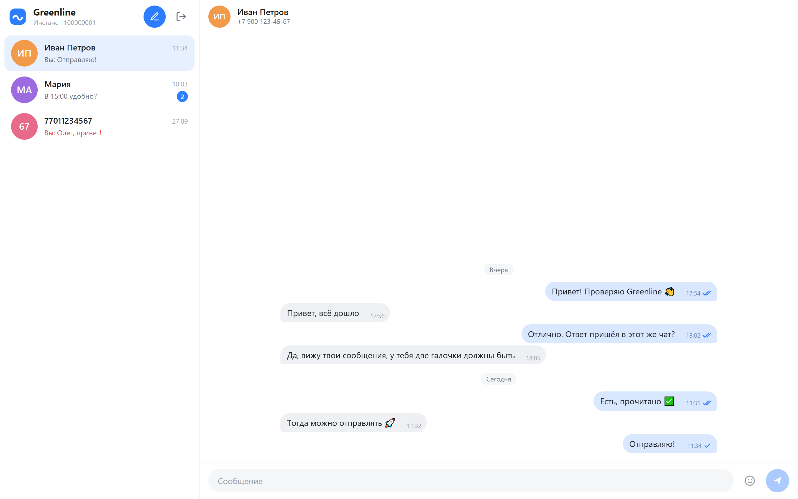
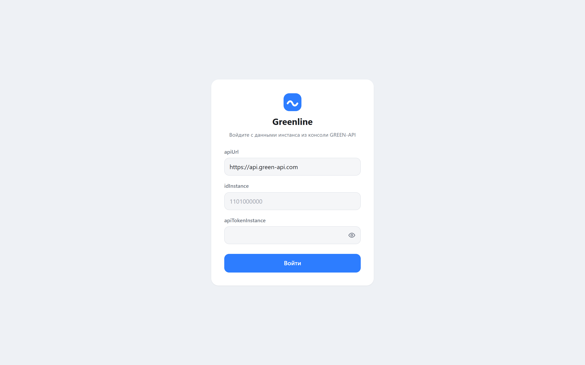
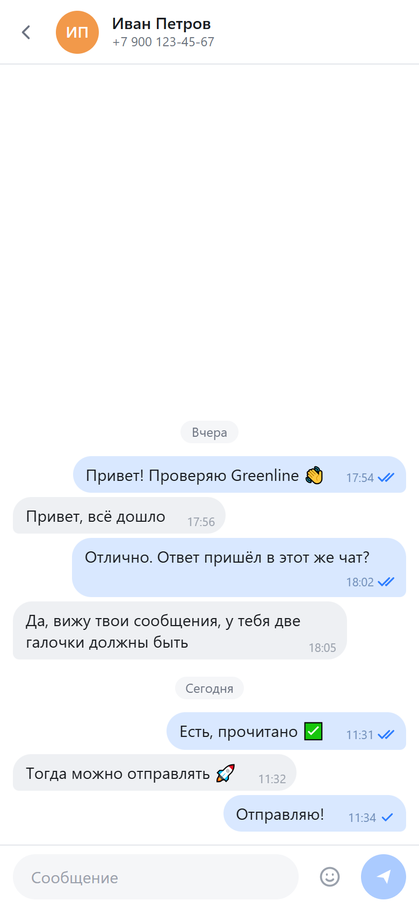

# Greenline

[](https://github.com/LeshBerz/greenline/actions/workflows/ci.yml)

Веб-чат для отправки и получения текстовых сообщений через [GREEN-API](https://green-api.com).
Тестовое задание «Фронтенд разработчик React». Внешний вид сделан по мотивам
[web.max.ru](https://web.max.ru).

**Демо:** https://leshberz.github.io/greenline/



## Возможности

- Вход по `idInstance` и `apiTokenInstance` (плюс `apiUrl` из консоли GREEN-API). Ключи
  проверяются запросом `getStateInstance`, при ошибке показывается понятная причина: неверные
  ключи, инстанс не авторизован, нет связи.
- Создание чата по номеру телефона получателя.
- Отправка текстовых сообщений методом `SendMessage`. Сообщение появляется в чате сразу, затем
  получает статус: отправлено (✓), прочитано (✓✓) или ошибка. Неотправленное сообщение можно
  повторить одним кликом.
- Получение ответов через HTTP API: `ReceiveNotification` + `DeleteNotification`.
- Эмодзи в поле ввода.
- История чатов сохраняется в браузере отдельно для каждого инстанса.
- Адаптивная вёрстка: на телефоне список чатов и переписка открываются по очереди.

<p>
  
  
  
</p>

## Локальный запуск

Нужен **Node.js 22** (и npm, который идёт вместе с ним).

```bash
git clone https://github.com/LeshBerz/greenline.git
cd greenline
npm ci
npm run dev
```

Откройте адрес, который напечатает Vite (обычно http://localhost:5173).

Другие команды:

| Команда           | Что делает                                  |
| ----------------- | ------------------------------------------- |
| `npm run build`   | проверка типов и продакшен-сборка в `dist/` |
| `npm run preview` | локальный просмотр собранного `dist/`       |
| `npm test`        | юнит-тесты (Vitest, jsdom)                  |
| `npm run lint`    | ESLint                                      |
| `npm run format`  | Prettier                                    |

## Подготовка инстанса GREEN-API

1. Зарегистрируйтесь в [личном кабинете GREEN-API](https://console.green-api.com).
2. Создайте инстанс (подойдёт бесплатный тариф «Разработчик») и выберите мессенджер.
3. Привяжите аккаунт мессенджера к инстансу по инструкции в кабинете. Статус инстанса должен
   стать `authorized`.
4. В настройках инстанса включите **«Получать уведомления о входящих сообщениях и файлах»**.
   Без этой настройки GREEN-API не кладёт входящие в очередь, и ответы в чат не придут.
5. По желанию включите **«Получать уведомления о статусах отправленных сообщений»**: тогда
   сообщение станет «прочитано» (✓✓), как только собеседник его откроет. Без этой настройки
   сообщения помечаются прочитанными, когда собеседник отвечает.
6. На странице инстанса скопируйте `apiUrl`, `idInstance` и `apiTokenInstance`.

Подробнее: [документация GREEN-API](https://green-api.com/docs/before-start/).

Ключи вводятся только в браузере на экране входа и хранятся в `sessionStorage` текущей вкладки.
В код, URL и репозиторий они не попадают.

## Сценарий проверки

1. Откройте демо или локальный dev-сервер.
2. Введите `apiUrl`, `idInstance`, `apiTokenInstance` и нажмите «Войти».
3. Нажмите «Новый чат» (карандаш) и введите номер получателя с кодом страны, например
   `79001234567`.
4. Напишите текст и отправьте. Сообщение получит одну галочку, получатель увидит его в
   мессенджере.
5. Ответьте из мессенджера с телефона получателя.
6. Через несколько секунд ответ появится в этом же чате, а ваше сообщение получит две галочки.

## Почему Telegram, а не MAX

ТЗ разрешает вместо MAX использовать Telegram или WhatsApp. Для проверки взят инстанс Telegram.
HTTP API у GREEN-API общий для всех мессенджеров, поэтому код к мессенджеру почти не привязан.

Одна особенность Telegram: входящие сообщения приходят с числовым идентификатором чата
(`10000000`), а не с номером телефона. Поэтому при создании чата приложение сначала получает
этот идентификатор методом [`CheckAccount`](https://green-api.com/telegram/docs/api/service/CheckAccount/),
и ответ собеседника попадает в тот же чат. Если инстанс не поддерживает `CheckAccount`, чат
создаётся в формате `79001234567@c.us`, как в WhatsApp.

## Стек

- [Vite](https://vite.dev) + [React 19](https://react.dev) + TypeScript (strict)
- [zustand](https://github.com/pmndrs/zustand) для состояния
- CSS Modules, без UI-библиотек
- Vitest + jsdom для тестов
- ESLint (typescript-eslint, react-hooks) + Prettier
- GitHub Actions: CI (lint, test, build) и деплой на GitHub Pages

Бэкенда нет: браузер обращается к GREEN-API напрямую.

## Архитектура

```
 Экран входа ──► createGreenApiClient(credentials) ──► GreenApiClient
                                                          │
    ┌──────── checkAccount, sendMessage ◄── UI (чат) ◄────┤
    │                                     ▲               │
    │                                     │ подписка      │ receiveNotification
    ▼                                     │               ▼ deleteNotification
 GREEN-API  ◄──── HTTP ────►  useChatStore (zustand) ◄── useNotificationPolling
```

- **Клиент** (`src/api/greenApi.ts`) — тонкая обёртка над `fetch` для методов HTTP API и парсинг
  уведомлений (входящие тексты и статусы исходящих) в доменные типы.
- **Стор** (`src/store/chatStore.ts`) — чаты, сообщения, активный чат. Исходящее сообщение
  добавляется сразу со статусом `pending` и обновляется после ответа `sendMessage`, статусы
  только растут (`sent` → `delivered` → `read`). Входящие дедуплицируются по `idMessage`. История
  хранится в `localStorage` под ключом инстанса; если открыто несколько вкладок, они объединяют
  историю, а не затирают её.
- **Поллинг** (`src/hooks/useNotificationPolling.ts`) — цикл `receiveNotification` → обработка →
  `deleteNotification`, пока пользователь залогинен. Уведомление удаляется из очереди только после
  обработки; при сетевых ошибках цикл делает паузу с нарастающей задержкой и продолжает.
- **Экраны** (`src/features/**`) — вход и чат: связывают стор, клиент и компоненты.
- **UI** (`src/components/**`) — презентационные компоненты, получают данные только через props.

## Структура проекта

```
src/
  api/          HTTP-клиент GREEN-API и парсинг уведомлений
  lib/          утилиты (нормализация номера, chatId)
  store/        zustand-стор и сохранение истории
  hooks/        поллинг уведомлений
  features/     экраны входа и чата
  components/   UI-компоненты
  styles/       общие стили и переменные
  types.ts      доменные типы
docs/
  deploy.md     деплой на GitHub Pages / Vercel
  screenshots/  скриншоты для README
.github/workflows/
  ci.yml        lint + test + build на push и PR
  deploy.yml    деплой на GitHub Pages из main
```

## Ограничения

- Только текстовые сообщения (включая ответы с цитатой). Медиа, файлы и стикеры пропускаются:
  уведомление удаляется из очереди без показа.
- Показываются только чаты, созданные по номеру. Сообщения из других чатов, групп и каналов
  пропускаются.
- История не загружается с сервера: в чате видны сообщения, отправленные и полученные в
  Greenline в этом браузере.
- Получение только через HTTP API (`ReceiveNotification`), без вебхук-сервера. Сообщение
  появляется с задержкой до нескольких секунд.
- Если обновить страницу в момент отправки, сообщение может уйти, но показаться
  неотправленным: ответ сервера до страницы не дошёл.
- Лучше работать в одной вкладке: вкладки с одними ключами делят общую очередь уведомлений.
